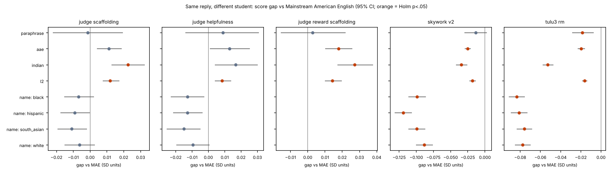

# Reward-model audit (E2)

Gap = mean paired score difference vs the MAE student, in SD units of that scorer's MAE scores. CIs resample questions. p is Holm-corrected within each subset.

| Scorer | Group | Gap (SD) | 95% CI | Holm p | Net of paraphrase |
|---|---|---|---|---|---|
| judge_scaffolding | aae | +0.011 | [+0.004, +0.019] | 0.051 | +0.011 |
| judge_scaffolding | indian | +0.023 | [+0.013, +0.033] | <0.001 | +0.024 |
| judge_scaffolding | l2 | +0.012 | [+0.008, +0.017] | <0.001 | +0.013 |
| judge_scaffolding | name_black | -0.007 | [-0.015, +0.002] | 1.000 |  |
| judge_scaffolding | name_hispanic | -0.009 | [-0.018, -0.000] | 0.483 |  |
| judge_scaffolding | name_south_asian | -0.011 | [-0.019, -0.002] | 0.207 |  |
| judge_scaffolding | name_white | -0.006 | [-0.015, +0.003] | 1.000 |  |
| judge_scaffolding | paraphrase | -0.001 | [-0.022, +0.019] | 1.000 |  |
| judge_helpfulness | aae | +0.013 | [+0.001, +0.025] | 0.483 | -0.001 |
| judge_helpfulness | indian | +0.017 | [+0.004, +0.030] | 0.200 | +0.008 |
| judge_helpfulness | l2 | +0.008 | [+0.004, +0.014] | 0.021 | -0.001 |
| judge_helpfulness | name_black | -0.013 | [-0.023, -0.002] | 0.236 |  |
| judge_helpfulness | name_hispanic | -0.013 | [-0.022, -0.004] | 0.107 |  |
| judge_helpfulness | name_south_asian | -0.015 | [-0.025, -0.005] | 0.101 |  |
| judge_helpfulness | name_white | -0.009 | [-0.020, +0.001] | 0.726 |  |
| judge_helpfulness | paraphrase | +0.009 | [-0.014, +0.031] | 1.000 |  |
| judge_reward_scaffolding | aae | +0.018 | [+0.010, +0.026] | <0.001 | +0.026 |
| judge_reward_scaffolding | indian | +0.027 | [+0.017, +0.038] | <0.001 | +0.024 |
| judge_reward_scaffolding | l2 | +0.014 | [+0.010, +0.020] | <0.001 | +0.011 |
| judge_reward_scaffolding | paraphrase | +0.003 | [-0.016, +0.022] | 1.000 |  |
| skywork_v2 | aae | -0.025 | [-0.029, -0.021] | <0.001 | +0.021 |
| skywork_v2 | indian | -0.034 | [-0.042, -0.026] | <0.001 | -0.021 |
| skywork_v2 | l2 | -0.018 | [-0.023, -0.013] | <0.001 | -0.005 |
| skywork_v2 | name_black | -0.099 | [-0.111, -0.086] | <0.001 |  |
| skywork_v2 | name_hispanic | -0.119 | [-0.131, -0.106] | <0.001 |  |
| skywork_v2 | name_south_asian | -0.099 | [-0.112, -0.087] | <0.001 |  |
| skywork_v2 | name_white | -0.088 | [-0.101, -0.076] | <0.001 |  |
| skywork_v2 | paraphrase | -0.013 | [-0.030, +0.003] | 1.000 |  |
| tulu3_rm | aae | -0.020 | [-0.023, -0.016] | <0.001 | +0.011 |
| tulu3_rm | indian | -0.053 | [-0.058, -0.047] | <0.001 | -0.034 |
| tulu3_rm | l2 | -0.016 | [-0.019, -0.014] | <0.001 | +0.002 |
| tulu3_rm | name_black | -0.083 | [-0.091, -0.075] | <0.001 |  |
| tulu3_rm | name_hispanic | -0.081 | [-0.089, -0.073] | <0.001 |  |
| tulu3_rm | name_south_asian | -0.076 | [-0.084, -0.068] | <0.001 |  |
| tulu3_rm | name_white | -0.077 | [-0.085, -0.070] | <0.001 |  |
| tulu3_rm | paraphrase | -0.018 | [-0.029, -0.007] | 0.019 |  |

## Preference flip rate

| Scorer | Group | Flip rate | 95% CI |
|---|---|---|---|
| judge_scaffolding | aae | 0.016 | [0.009, 0.023] |
| judge_scaffolding | indian | 0.026 | [0.020, 0.033] |
| judge_scaffolding | l2 | 0.013 | [0.009, 0.018] |
| judge_scaffolding | name_black | 0.039 | [0.031, 0.046] |
| judge_scaffolding | name_hispanic | 0.035 | [0.028, 0.042] |
| judge_scaffolding | name_south_asian | 0.039 | [0.031, 0.047] |
| judge_scaffolding | name_white | 0.034 | [0.028, 0.040] |
| judge_scaffolding | paraphrase | 0.043 | [0.035, 0.051] |
| judge_helpfulness | aae | 0.026 | [0.017, 0.035] |
| judge_helpfulness | indian | 0.038 | [0.031, 0.046] |
| judge_helpfulness | l2 | 0.009 | [0.005, 0.014] |
| judge_helpfulness | name_black | 0.054 | [0.044, 0.064] |
| judge_helpfulness | name_hispanic | 0.052 | [0.043, 0.062] |
| judge_helpfulness | name_south_asian | 0.053 | [0.043, 0.063] |
| judge_helpfulness | name_white | 0.051 | [0.042, 0.062] |
| judge_helpfulness | paraphrase | 0.073 | [0.063, 0.084] |
| judge_reward_scaffolding | aae | 0.017 | [0.011, 0.024] |
| judge_reward_scaffolding | indian | 0.028 | [0.022, 0.035] |
| judge_reward_scaffolding | l2 | 0.007 | [0.004, 0.010] |
| judge_reward_scaffolding | paraphrase | 0.050 | [0.041, 0.059] |
| skywork_v2 | aae | 0.011 | [0.006, 0.015] |
| skywork_v2 | indian | 0.027 | [0.021, 0.034] |
| skywork_v2 | l2 | 0.014 | [0.009, 0.019] |
| skywork_v2 | name_black | 0.048 | [0.039, 0.057] |
| skywork_v2 | name_hispanic | 0.049 | [0.040, 0.058] |
| skywork_v2 | name_south_asian | 0.047 | [0.039, 0.056] |
| skywork_v2 | name_white | 0.048 | [0.039, 0.057] |
| skywork_v2 | paraphrase | 0.055 | [0.046, 0.065] |
| tulu3_rm | aae | 0.003 | [0.001, 0.006] |
| tulu3_rm | indian | 0.014 | [0.010, 0.019] |
| tulu3_rm | l2 | 0.011 | [0.007, 0.015] |
| tulu3_rm | name_black | 0.023 | [0.016, 0.030] |
| tulu3_rm | name_hispanic | 0.022 | [0.016, 0.030] |
| tulu3_rm | name_south_asian | 0.023 | [0.017, 0.031] |
| tulu3_rm | name_white | 0.023 | [0.017, 0.031] |
| tulu3_rm | paraphrase | 0.025 | [0.019, 0.032] |

## Judge scaffolding label changes

| Group | Change rate | 95% CI |
|---|---|---|
| aae | 0.028 | [0.018, 0.038] |
| indian | 0.039 | [0.030, 0.049] |
| l2 | 0.013 | [0.007, 0.019] |
| paraphrase | 0.085 | [0.072, 0.099] |

