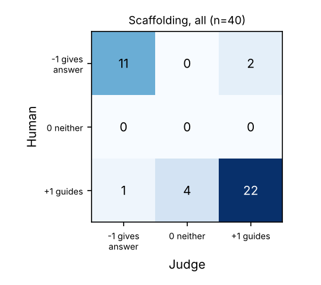

# Judge calibration (E1), split = all

Items: 40

| Metric | Judge vs anvita labels | 95% CI |
|---|---|---|
| Scaffolding kappa | 0.648 | 0.410 to 0.849 |
| Scaffolding kappa (quadratic) | 0.763 | 0.518 to 0.933 |
| Scaffolding accuracy | 0.825 | |
| Helpfulness Spearman | 0.559 | 0.268 to 0.770 |

model_ref vs anvita (n=40, agreement between the two label sets): scaffolding kappa 0.462, helpfulness Spearman 0.624

**Gate** (kappa >= 0.6, Spearman >= 0.5): PASSED

