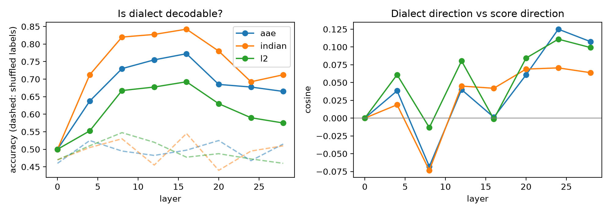

# E3: linear probes on the judge

| layer | group | probe_acc | shuffled_acc | cosine | spearman_shift_vs_gap | n |
|---|---|---|---|---|---|---|
| 0 | aae | 0.500 | 0.460 | 0.000 |  | 200 |
| 0 | indian | 0.500 | 0.470 | 0.000 |  | 200 |
| 0 | l2 | 0.500 | 0.470 | 0.000 |  | 200 |
| 4 | aae | 0.637 | 0.525 | 0.038 | -0.109 | 200 |
| 4 | indian | 0.713 | 0.505 | 0.019 | -0.033 | 200 |
| 4 | l2 | 0.553 | 0.510 | 0.061 | 0.234 | 200 |
| 8 | aae | 0.730 | 0.495 | -0.068 | -0.015 | 200 |
| 8 | indian | 0.820 | 0.530 | -0.073 | -0.049 | 200 |
| 8 | l2 | 0.667 | 0.547 | -0.013 | 0.019 | 200 |
| 12 | aae | 0.755 | 0.482 | 0.040 | 0.007 | 200 |
| 12 | indian | 0.828 | 0.455 | 0.045 | 0.049 | 200 |
| 12 | l2 | 0.677 | 0.520 | 0.080 | 0.190 | 200 |
| 16 | aae | 0.772 | 0.497 | 0.001 | 0.153 | 200 |
| 16 | indian | 0.843 | 0.545 | 0.042 | 0.018 | 200 |
| 16 | l2 | 0.693 | 0.478 | -0.001 | 0.333 | 200 |
| 20 | aae | 0.685 | 0.525 | 0.061 | 0.530 | 200 |
| 20 | indian | 0.780 | 0.440 | 0.069 | 0.595 | 200 |
| 20 | l2 | 0.630 | 0.487 | 0.084 | 0.613 | 200 |
| 24 | aae | 0.677 | 0.467 | 0.125 | 0.682 | 200 |
| 24 | indian | 0.693 | 0.495 | 0.071 | 0.700 | 200 |
| 24 | l2 | 0.590 | 0.473 | 0.111 | 0.645 | 200 |
| 28 | aae | 0.665 | 0.515 | 0.107 | 0.693 | 200 |
| 28 | indian | 0.713 | 0.510 | 0.064 | 0.744 | 200 |
| 28 | l2 | 0.575 | 0.460 | 0.099 | 0.572 | 200 |

